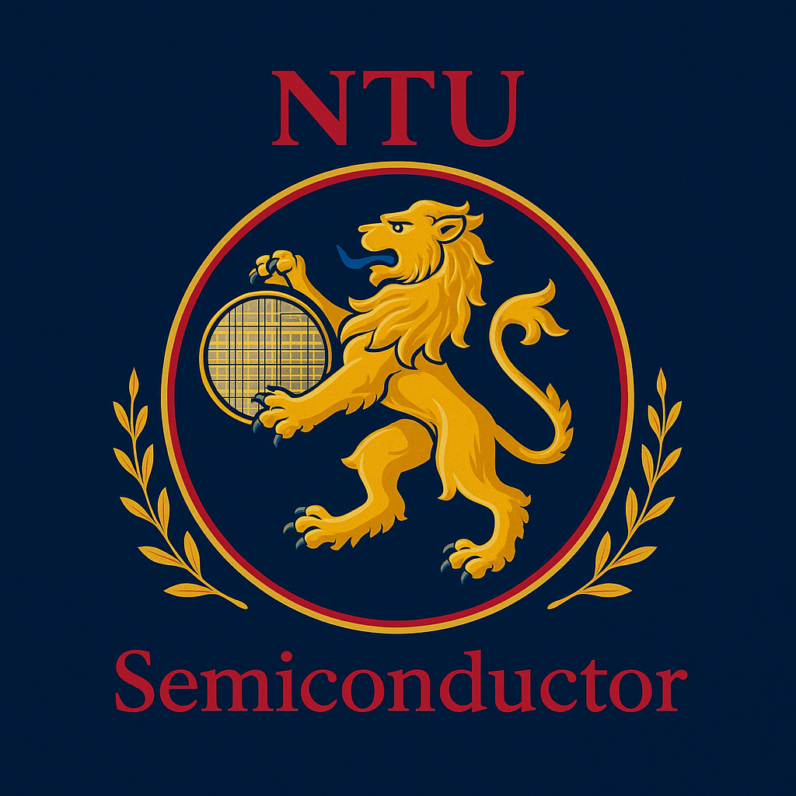
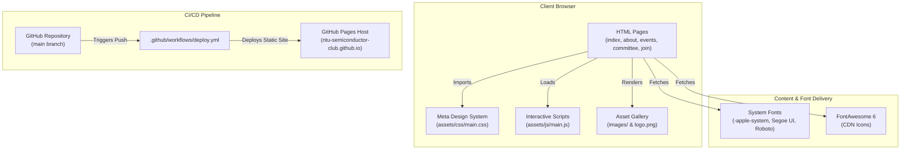

# Architecture & Brand Design Guide 🛠️

Welcome to the **NTU Semiconductor Club Website** developer architecture and brand design guide. This document serves as the authoritative single-source-of-truth specification for human developers and AI coding assistants.

---

## 📐 Brand Identity & Header Specification

All pages **must** strictly use the exact single-source-of-truth header branding markup:

```html
<a href="index.html" class="nav-brand">
  
  <div class="nav-brand-text">
    <span class="nav-brand-title">NTU Semiconductor Club</span>
    <span class="nav-brand-sub">Nanyang Technological University</span>
  </div>
</a>
```

### Brand Tokens Standard

* **Club Name (`.nav-brand-title`)**: `NTU Semiconductor Club` *(Title case, exact string)*
* **Sub-Brand Badge (`.nav-brand-sub`)**: `Nanyang Technological University` *(Uppercase blue subtitle, exact string)*
* **Logo Asset (`.nav-brand-img`)**: [`images/logo.png`](file:///Users/ray/dev/clubweb/images/logo.png) *(Height: 44px, drop shadow elevation)*

---

## 📐 High-Level Architecture Diagram



---

## 🎨 Meta Astryx Design System & Tokens

The visual language is aligned with Meta's open-source [Astryx Design System](https://github.com/facebook/astryx) powering 13,000+ internal apps. Tokens are centralized in [`assets/css/main.css`](file:///Users/ray/dev/clubweb/assets/css/main.css) using CSS custom properties with native `light-dark()` color scheme support:

```css
:root {
  color-scheme: light dark;

  /* Brand Palette */
  --color-brand: #0866ff;
  --color-brand-hover: #0052cc;
  --color-accent: light-dark(#0866ff, #4589ff);

  /* Surface & Backgrounds */
  --color-background-body: light-dark(#f0f2f5, #18191a);
  --color-background-surface: light-dark(#ffffff, #242526);
  --color-background-card: light-dark(#ffffff, #242526);
  --color-background-popover: light-dark(#ffffff, #262626);
  --color-background-muted: light-dark(#eef0f4, #2a2b2d);

  /* Typography & Text */
  --color-text-primary: light-dark(#050505, #e4e6eb);
  --color-text-secondary: light-dark(#65676b, #b0b3b8);
  --color-border: light-dark(#e4e6eb, #393a3b);

  /* Elevation (3-tier Astryx scale) */
  --shadow-low: 0 1px 2px rgba(0, 0, 0, 0.08), 0 2px 4px rgba(0, 0, 0, 0.04);
  --shadow-med: 0 4px 12px rgba(0, 0, 0, 0.12);
  --shadow-high: 0 12px 28px rgba(0, 0, 0, 0.22);

  /* Spacing & Radii Scale */
  --spacing-1: 4px;   --spacing-2: 8px;   --spacing-3: 12px;
  --spacing-4: 16px;  --spacing-6: 24px;  --spacing-8: 32px;
  --radius-inner: 4px; --radius-element: 8px; --radius-container: 12px;

  /* Astryx Layer Offset */
  --layer-offset: var(--spacing-2); /* 8px offset */
  --layer-z-index: 1200;
}
```

### 🪟 Astryx Layer (`core-layer--offset`) & UI Systems

Floating overlays, palettes, lightboxes, and accordions conform to the [Astryx Design System](https://facebook.github.io/astryx/) specifications:
1. **Context Anchor Positioning (`core-layer--offset`)**: Overlays align dynamically to trigger elements with an explicit `--layer-offset` (`8px` / `--spacing-2`).
2. **Collision Detection**: Overlays flip from bottom to top when colliding with viewport boundaries, clamping horizontally.
3. **Dismissal Stack (`useLayerDismissal`)**: Pressing `Escape` or clicking outside triggers light-dismissal. All layers declare `role="dialog"` with accessible `aria-haspopup` and `aria-expanded` state tracking.
4. **Astryx Command Palette (`Cmd+K` / `Ctrl+K`)**: Global instant search across pages, curriculum pillars, industrial site visits, committee leads, and community channels.
5. **Astryx Lightbox**: Accessible modal viewer with smooth scale-in zoom, backdrop blur, and captions for industrial visit photos.
6. **Astryx Accordion / Collapsible**: Accessible collapsible FAQ component with dynamic `max-height` transition and chevron rotation.
7. **Astryx Status Indicator**: Real-time pulsing badge indicator highlighting active semester enrollment.
8. **Astryx Theme Switcher**: Explicit dark/light mode toggle stored in `localStorage` with `[data-theme]` CSS token overrides and FOUC prevention.
9. **Astryx Toast System (`useToast`)**: Non-blocking toast notification stack in bottom-right corner for theme toggles and clipboard interactions.
10. **Astryx Event Category Filters**: Tabbed category filtering pills (`all`, `fab`, `industry`, `workshop`) with counter badges and animated display toggles.

See [`AGENTS.md`](file:///Users/ray/dev/clubweb/AGENTS.md) for strict AI agent rules, token specifications, and humanizer writing constraints.

---

## 📬 Official Contact & Community Channels Reference

| Channel | URL / Contact | Purpose |
| :--- | :--- | :--- |
| **Telegram Group** | [`https://t.me/+Wsb5No5hvnxlMjRl`](https://t.me/+Wsb5No5hvnxlMjRl) | Real-time member announcements & community chat |
| **LinkedIn Page** | [`https://www.linkedin.com/company/ntu-semiconductor-club/`](https://www.linkedin.com/company/ntu-semiconductor-club/) | Professional updates, company news, and networking |
| **Official Email** | [`mailto:ntu.semiconductor.club@ntu.edu.sg`](mailto:ntu.semiconductor.club@ntu.edu.sg) | Executive committee contact & corporate partnerships |
| **GitHub Org** | [`https://github.com/NTU-Semiconductor-Club`](https://github.com/NTU-Semiconductor-Club) | Open source code, repositories, and documentation |
