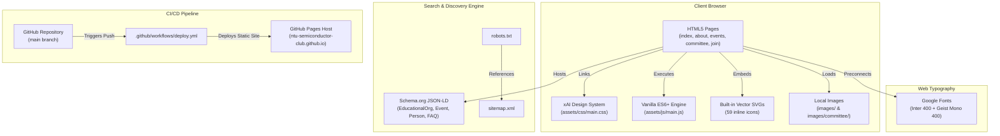

# Architecture & Technical Design Specification 🛠️

Welcome to the **NTU Semiconductor Club Website** (`clubweb`) developer architecture and technical specification. This document serves as the single source of truth for human maintainers and AI coding assistants.

---

## 1. High-Level Architecture

The website is a **pure static web stack** (HTML5, modern CSS3, native ES6+ vanilla JavaScript) deployed via GitHub Actions to GitHub Pages. It has **zero npm/Node.js build dependencies** at runtime and deploys instantly upon push.



---

## 2. xAI Design System Implementation

The site strictly implements the **xAI Design System** ([getdesign.md/x.ai/design-md](https://getdesign.md/x.ai/design-md)), characterized by stark monochrome minimalism, engineered cosmic restraint, and unmarketed technical clarity.

### 2.1 Color Tokens & Surface Hierarchy (`assets/css/main.css`)

```css
:root {
  color-scheme: dark;

  /* Surfaces: Strict near-black edge-to-edge. Zero light-mode counterpart */
  --color-canvas: #0a0a0a;          /* Main page canvas */
  --color-canvas-soft: #1a1c20;     /* Nav hover, popovers, input fills */
  --color-canvas-card: #191919;     /* Content and feature cards */
  --color-canvas-mid: #363a3f;      /* Nested code badges, kbd chips */
  --color-hairline: #212327;        /* 1px structural dividing lines */

  /* Ink & Typography */
  --color-primary: #ffffff;         /* Headings, primary text */
  --color-on-primary: #0a0a0a;      /* Text on white pill */
  --color-body: #dadbdf;            /* Primary body copy */
  --color-mute: #7d8187;            /* Monospace eyebrows, captions */

  /* Translucency */
  --color-border-pill: rgba(255, 255, 255, 0.22);
  --color-border-pill-hover: rgba(255, 255, 255, 0.65);

  /* Illustrative Accents (Used Sparingly) */
  --color-accent-sunset: #ff7a17;   /* Pulse cues, toast dot */
  --color-accent-dusk: #7c3aed;
  --color-accent-twilight: #c4b5fd;
  --color-accent-breeze: #a0c3ec;
}
```

### 2.2 Typography Rules: Strict Weight 400
- **Two-Face System**:
  - **Geometric Sans (`Inter`)**: Used for all display headings and body copy. Weight 400 is enforced globally (`h1, h2, h3, h4, h5, h6 { font-weight: 400 !important; }`). Negative tracking is applied to display sizes:
    - `display-xl / h1`: 96px, line-height 96px, letter-spacing `-0.03em` (scales smoothly on mobile via `clamp(36px, 7vw, 96px)`).
    - `display-lg`: 72px, line-height 72px, letter-spacing `-0.025em`.
    - `display-md / h2`: 48px, line-height 48px, letter-spacing `-0.02em`.
    - `display-sm / h3`: 32px, line-height 36px, letter-spacing `-0.015em`.
  - **Monospace Code Face (`Geist Mono`)**: Used for uppercase section eyebrows (`.eyebrow-mono`), metric numbers, dates, and technical tags (`letter-spacing: 1.4px`).
- **Code-Comment Eyebrows**: Every section is prefixed with a code-comment style eyebrow (e.g., `// HARDWARE ARCHITECTURE & SILICON CURRICULUM`, `// AY2025/26 SEMESTER 2`).

### 2.3 Interactive Shapes & Hairline Elevation
- **Universal Pill (`border-radius: 9999px`)**:
  - Every button (`.btn`, `.btn-primary`, `.btn-secondary`, `.filter-pill`) is a pill.
  - **Canonical Button**: Outlined pill with translucent white border `rgba(255, 255, 255, 0.22)` and transparent background.
  - **Primary Button (Rare)**: White-filled pill (`background: #ffffff; color: #0a0a0a;`).
- **Cards (`border-radius: 8px`)**:
  - Cards use tight 8px radii, `#191919` surface fill, and `1px solid #212327` hairline borders.
- **Zero Drop Shadows**:
  - All `box-shadow` values are `none`. Elevation is achieved solely through hairline borders and surface tone contrast.

---

## 3. Built-In Vector SVG System

All 59 icons across the site are built out as self-contained, inline vector SVGs (`.xai-icon`):
- **Zero CDN Dependencies**: No Font Awesome CDN link.
- **Benefits**: Instant zero-latency rendering, zero network failure points, zero missing-glyph fallback boxes `[X]`, and exact color inheritance via `currentColor`.

---

## 4. Mobile & Touch Ergonomics (< 768px & < 480px)

The website is engineered for seamless mobile and touch usability:
- **Responsive Navigation**:
  - On `< 640px`, the search button automatically collapses from text+kbd to a sleek circular icon pill (`width: 36px; height: 36px`).
  - On `< 480px`, the sub-brand text hides to preserve clean horizontal spacing.
  - Mobile menu drawer smoothly overlays the viewport with blurred backdrop (`rgba(10, 10, 10, 0.98)`).
- **Auto-Dismissal & Gestures (`assets/js/main.js`)**:
  - Mobile drawer closes automatically when any navigation link is clicked, when tapping outside, or on `Escape`.
  - Background scrolling is locked (`overflow: hidden`) during active modals or lightboxes.
  - Touch target heights meet or exceed WCAG 44×44px standards.
- **iOS Safari Auto-Zoom Prevention**:
  - Command palette search inputs enforce `font-size: 16px;` on mobile viewports to prevent iOS Safari from zooming the page on focus.
- **Mobile Popovers**:
  - On viewports `< 640px`, committee bio popovers convert from floating offsets into anchored bottom sheets/modals with outside tap dismissal.

---

## 5. SEO & Crawler Discovery Architecture

To maximize discoverability on Google, Bing, DuckDuckGo, and social platforms:
- **Robots Directives (`robots.txt`)**: Explicit crawl permissions for all search engines (`Googlebot`, `Bingbot`, `Applebot`, `DuckDuckBot`) with canonical sitemap pointer.
- **Sitemap Index (`sitemap.xml`)**: Timestamped (`2026-11-10`) with `weekly` change frequencies and priority weighting (1.00 for home, 0.95 for join).
- **Metadata & Open Graph**: Every page contains unique titles, keyword tags, canonical URLs, and Open Graph / Twitter Card tags.
- **Schema.org Structured Data (JSON-LD)**:
  - `index.html`: `EducationalOrganization` + `WebSite`
  - `about.html`: `AboutPage`
  - `events.html`: `ItemList` with `Event` entries
  - `committee.html`: `ItemList` with `Person` entities
  - `join.html`: `FAQPage` (triggers Google Search FAQ Rich Snippets)

---

## 6. Local Development & Verification

```bash
# Start local daemon server
python3 -m http.server 8000

# Automated governance checks
python3 -c "
import glob, re, os, sys
# Check 1: Pure static stack
assert not any(os.path.exists(p) for p in ['package.json', 'node_modules'])
# Check 2: Banned AI buzzwords
pat = re.compile(r'\b(vibrant|landscape|pivotal|testament|foster|delv|unmatched|beacon|tapestry|spearhead|empower|supercharg|synerg)', re.I)
for f in glob.glob('*.html'):
    for i, line in enumerate(open(f), 1):
        if pat.search(line): sys.exit(1)
# Check 3: Zero theme toggles or light-mode scripts
for f in glob.glob('*.html') + ['assets/js/main.js', 'assets/css/main.css']:
    assert 'theme-toggle' not in open(f).read()
print('All governance checks passed.')
"
```
